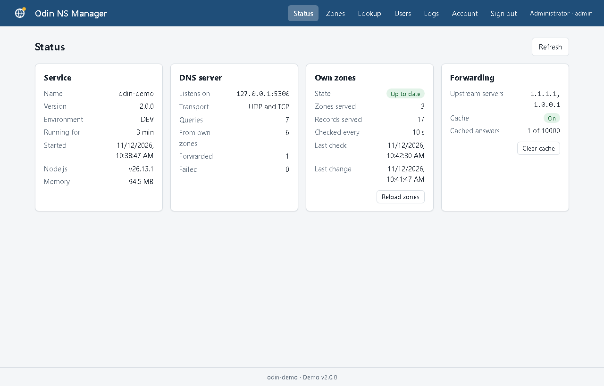

# odin-ns-manager

The manager service of the Odin name server stack. It runs the DNS server, the
management API, its user interface and the DNS client side in one process. The
zones and records that are managed in the browser or through the API are stored
in MongoDB, and answered by the DNS server.

Current version: **2.2.0** - see the [release notes](#release-notes).


It brings four packages together:

| Package | Role in the manager |
| --- | --- |
| [njord-ns-server](https://github.com/csabatibortoth/njord-ns-server) | The DNS server: answers queries over UDP and TCP, and looks up unknown names at upstream DNS servers. Its record classes and validators are what the zones are built of |
| [freya-ns-api](https://github.com/csabatibortoth/freya-ns-api) | The management API: zones and records, users, authentication, logging and the MongoDB connection |
| [bragi-ns-client](https://github.com/csabatibortoth/bragi-ns-client) | The DNS client: a cached replacement of `dns.lookup` for outgoing connections |
| [athena-ui-js](https://github.com/csabatibortoth/athena-ui) | The user interface: page layout, menu, login form and dialogs |

## Status

| Area | Status |
| --- | --- |
| DNS server over UDP and TCP | Available |
| Forwarding of unknown names to upstream DNS servers | Available |
| In-memory cache of answers | Available |
| Management API: users and authentication | Available |
| Zones and records stored in MongoDB, answered from memory | Available |
| Management of zones and records through the API | Available |
| Zone transfers (AXFR) to secondary servers | Planned |
| User interface in the browser | Available |

A query for a name of one of its own zones is answered by the server itself;
every other query is forwarded to the upstream DNS servers. The zones, the users
and the service itself are managed in the browser, or through the API.

## Requirements

- Node.js 22 or newer
- A MongoDB server the manager can reach, for the management API and the zones.
  Without it the DNS server runs as a forwarder only.

## Getting started

```
npm install
npm start        # or: npm run dev, which restarts on every change
```

By default the DNS server listens on `127.0.0.1:53` (UDP and TCP), and the
user interface and the management API on `http://localhost:45451`, with MongoDB
at `127.0.0.1:27017`.

Port 53 usually needs administrator rights and may be in use already. To try
the server on another port:

```
ODIN_NS_PORT=5300 npm start
nslookup -port=5300 example.com 127.0.0.1
```

When MongoDB is not reachable at the start, the error is logged and the DNS
server keeps running as a forwarder: no zones are served and the management API
is not started until the next start.

On the first start, when there are no users yet, an admin account named `admin`
is created. Set `FREYA_ADMIN_PWD` beforehand to choose its password; otherwise a
random password is printed once to the console. Open `http://localhost:45451`,
sign in with it, and change it on the **Account** page.

Without the browser, three requests put a name on the air: log in, create a zone, and add
a record to it.

```
curl -X POST http://localhost:45451/api/auth/login \
  -H "Content-Type: application/json" \
  -d '{"username":"admin","password":"<password>"}'

curl -X POST http://localhost:45451/api/zones \
  -H "Authorization: Bearer <token>" -H "Content-Type: application/json" \
  -d '{"name":"example.test","soa":{"host":"ns1.example.test"}}'

curl -X POST http://localhost:45451/api/zones/<zoneId>/records \
  -H "Authorization: Bearer <token>" -H "Content-Type: application/json" \
  -d '{"name":"www","type":"A","data":{"target":"192.0.2.1"}}'

nslookup www.example.test 127.0.0.1
```

The first answer holds the `token`, the second the `id` of the zone.

## Configuration

Defaults live in `config/config.js`. Every value can be overridden with an
environment variable, so secrets do not have to be stored in the file.

### General

| Variable | Default | Purpose |
| --- | --- | --- |
| `ODIN_TYPE` | `DEV` | Environment type. Queries are printed to the console in `DEV`. Anything else requires a private `ODIN_SECRET` |
| `ODIN_SECRET` | `Test` | Key used to sign the login tokens of the API |
| `ODIN_SERVER_NAME` / `ODIN_COMPANY_NAME` | `odin-ns-manager-1` / `YourCompany` | Shown in the welcome message of the API |
| `ODIN_LOGGING_ENABLED` / `ODIN_LOG_FOLDER` | `true` / `C:\Temp\Odin\Logs` | File logging |

### DNS server

| Variable | Default | Purpose |
| --- | --- | --- |
| `ODIN_NS_ADDRESS` / `ODIN_NS_PORT` | `127.0.0.1` / `53` | Where the DNS server listens |
| `ODIN_NS_TCP_ENABLED` | `true` | Listen on TCP next to UDP |
| `ODIN_NS_ZONES_ENABLED` | `true` | Answer the zones and records of the database. Set to `false` to forward every query |
| `ODIN_NS_ZONE_REFRESH` | `10` | Seconds between two checks of the database for changed zones |
| `ODIN_NS_UPSTREAM` | `1.1.1.1,1.0.0.1` | Comma separated DNS servers that are asked for unknown names. Empty means the DNS servers of the system |
| `ODIN_NS_UPSTREAM_TIMEOUT` / `ODIN_NS_UPSTREAM_TRIES` | `2000` / `2` | Milliseconds to wait for an upstream answer, and the number of attempts |
| `ODIN_NS_CACHE_ENABLED` | `true` | Keep answers in memory |
| `ODIN_NS_CACHE_MAX_ENTRIES` | `10000` | Size of the cache; the oldest entry is dropped when it is full |
| `ODIN_NS_NEGATIVE_CACHE_TTL` | `30` | Seconds a "no such name" or "no such record" answer is kept |

### Management API

| Variable | Default | Purpose |
| --- | --- | --- |
| `ODIN_API_ENABLED` | `true` | Start the management API. Set to `false` to run the DNS server only; the zones of the database are still served |
| `ODIN_HTTP_ENABLED` / `ODIN_HTTP_PORT` | `true` / `45451` | Plain HTTP listener |
| `ODIN_HTTPS_ENABLED` / `ODIN_HTTPS_PORT` | `false` / `45452` | HTTPS listener; takes precedence over HTTP when enabled |
| `ODIN_AUTH_ENABLED` | `true` | Set to `false` to skip token checks. For local development only |
| `ODIN_UI_ENABLED` | `true` | Serve the user interface next to the API |
| `ODIN_DNS_WRITE_ROLES` | `admin` | Roles that may change zones and records, comma separated, e.g. `admin,user`. Every signed-in user may read them |
| `ODIN_DB_ADDRESS` / `ODIN_DB_PORT` / `ODIN_DB_NAME` | `127.0.0.1` / `27017` / `odin-ns-manager-1` | MongoDB location |
| `ODIN_DB_USER` / `ODIN_DB_PWD` | `Test` / `Test` | MongoDB credentials; set the user to an empty value to connect without authentication |

These settings are handed to freya-ns-api as its own `FREYA_*` variables. A
`FREYA_*` variable that is set explicitly wins, and is also the way to reach
the settings that have no `ODIN_*` counterpart, such as `FREYA_DB_URI`,
`FREYA_TOKEN_EXPIRES_IN`, `FREYA_HTTPS_KEY` / `FREYA_HTTPS_CERT` and
`FREYA_ADMIN_USER` / `FREYA_ADMIN_EMAIL` / `FREYA_ADMIN_PWD`. See the
[freya-ns-api documentation](https://github.com/csabatibortoth/freya-ns-api#configuration).

## DNS server

### Own zones

A query for a name that is in one of the active zones of the database is
answered by the server itself, as an authoritative answer, and is never sent to
the upstream. When zones overlap, the one with the longest matching name
answers: `www.sub.example.com` belongs to `sub.example.com` when that zone
exists, and to `example.com` otherwise.

- **Records** – the active A, AAAA, CNAME, MX, NS, PTR, SRV and TXT records of
  the name, with their own TTL or the TTL of the zone, and the SOA record of the
  zone itself.
- **Aliases** – a CNAME record is answered together with the records of its
  target, which are looked up in the zones, or at the upstream when the target
  is outside of them.
- **Wildcards** – a `*` record stands for the names below it that do not exist.
- **No such name** – a name that is not in the zone is answered with "no such
  name"; a name that exists without records of the asked type gets an empty
  answer.
- **Inactive** zones and records are not served. The names of an inactive zone
  are forwarded to the upstream like any other name.

The zones are kept in memory, so a query never waits for the database. A change
that is made through the API of this process is served as soon as the request
is done. Changes that are made elsewhere, such as by another manager on the same
database, are noticed by the serial of the zone, within `ODIN_NS_ZONE_REFRESH`
seconds. When the database can not be read, the zones in memory are served on.

Zone transfers (AXFR) are refused, and responses have no authority section yet.

### Forwarding

Every other query is answered with the records the upstream DNS servers have
for it. The A, AAAA, CNAME, MX, NS, PTR, SOA, SRV and TXT records can be looked
up; a query for another type is answered with "not implemented".

- **Cache** – an answer is kept in memory until its TTL runs out, and is sent
  with the TTL that is left of it. The upstream only reports the TTL of A and
  AAAA records; the other records are kept for 60 seconds.
- **Negative cache** – names and records that do not exist are remembered for
  `ODIN_NS_NEGATIVE_CACHE_TTL` seconds. Timeouts and other failures are not.
- **One lookup per name** – queries for the same name and type that arrive
  while a lookup is in flight wait for that lookup instead of sending their own.

The cache lives in the memory of the process and is empty after a restart. It
is only for the answers of the upstream; the own zones are not in it.

## User interface

The user interface is served by the HTTP(S) server of the management API, at
`http://localhost:45451` by default, and works with the same accounts. It is
built on [Athena UI](https://github.com/csabatibortoth/athena-ui) and jQuery,
which are served from their packages: the page loads nothing from other servers.
It follows the light or dark mode of the system.

| Page | Who | What it does |
| --- | --- | --- |
| Status | signed in | The service, the DNS server and its query counts, the zones in memory, the cache and the upstream servers. Admins can reload the zones and clear the cache |
| Zones | signed in | List and search the zones; add, edit and delete them |
| *a zone* | signed in | The SOA record and the records of a zone; add, edit and delete records |
| Lookup | signed in | Asks the DNS server for a name, and shows where the answer came from |
| Users | admin | List, add, edit and delete users, and set their passwords |
| Logs | admin | The general, error and security log of a day |
| Account | signed in | Your profile and your password |

Zones and records can be changed by the roles in `ODIN_DNS_WRITE_ROLES`; the
other users see them read-only.

### Screenshots

The screenshots are of a demo installation with sample zones.

| | |
| --- | --- |
|  **Sign in** |  **Status** |
|  **Zones** |  **The records of a zone** |
|  **Adding a record**: the fields follow the type |  **A value that is not valid** is marked at its field |
|  **Saved**: the serial of the zone is raised |  **Lookup**, answered from an own zone |
|  **Users** |  **Logs** |
|  **Status** after some use |  **Dark mode** |

## Management API

All paths are under `/api`. Requests and responses are JSON. After logging in,
send the token with every request as `Authorization: Bearer <token>`.

| Method | Path | Who | Purpose |
| --- | --- | --- | --- |
| GET | `/` | anyone | Welcome message |
| POST | `/auth/login` | anyone | `{ username, password }` returns a token |
| GET | `/auth/me` | signed in | The current user |
| POST | `/auth/logout` | signed in | Revokes every token of the current user |
| GET, POST | `/users` | admin | List and create users |
| GET, PATCH, DELETE | `/users/:id` | admin or self | Read, update and delete a user |
| PUT | `/users/:id/password` | admin or self | Change a password |
| GET, POST | `/zones` | signed in, admin | List and create zones: `{ name, soa: { host, ... }, ttl?, active? }` |
| GET, PATCH, DELETE | `/zones/:zoneId` | signed in, admin | Read, update and delete a zone. Deleting a zone deletes its records |
| GET, POST | `/zones/:zoneId/records` | signed in, admin | List and create records: `{ name, type, data, ttl?, active? }` |
| GET, PATCH, DELETE | `/zones/:zoneId/records/:recordId` | signed in, admin | Read, update and delete a record |

Zones and records can be read by every signed-in user, and changed by the roles
in `ODIN_DNS_WRITE_ROLES`. The SOA record of a zone and its serial are kept by
the API; the serial is raised on every change.

```
curl -X POST http://localhost:45451/api/auth/login \
  -H "Content-Type: application/json" \
  -d '{"username":"admin","password":"<password>"}'
```

These endpoints are the ones of freya-ns-api; see its
[documentation](https://github.com/csabatibortoth/freya-ns-api#api) for the
details of every endpoint.

The manager adds these, for the service itself:

| Method | Path | Who | Purpose |
| --- | --- | --- | --- |
| GET | `/service/info` | anyone | Name, version, and whether signing in is needed |
| GET | `/service/status` | signed in | The state of the service, the DNS server, the zones and the cache |
| GET | `/service/lookup?name=&type=` | signed in | Asks the DNS server of the manager for a name |
| POST | `/service/zones/reload` | admin | Reads the zones from the database now |
| POST | `/service/cache/clear` | admin | Empties the cache of upstream answers |
| GET | `/service/logs?target=&date=&lines=` | admin | The end of a log file: `log`, `error` or `security`, of a day written as `YYYY-MM-DD` |

## Logs

When logging is enabled, three files are written per day to the log folder:
`log-<date>.log` (general), `error-<date>.log` (failures) and
`security-<date>.log` (logins and every change to a user). Changes to zones and
records, and every (re)load of the zones by the DNS server, are written to the
general log.

## Tests

```
npm test
```

The tests ask a DNS server on a local port for the names of zones that are held
in memory; they need no database.

## Project layout

| Path | Contents |
| --- | --- |
| `server.js` | Entry point: starts the DNS server, the management API and the user interface |
| `config/` | Configuration |
| `services/serverService/zoneService.js` | The own zones: loading from MongoDB and answering from memory |
| `services/serverService/searchService.js` | Upstream lookups and the in-memory cache |
| `services/serverService/statusService.js` | Counters of the DNS server, for the status page |
| `services/apiService/apiService.js` | Database connection, start and stop of the management API, logging |
| `services/apiService/serviceRoutes.js` | The `/api/service` endpoints |
| `services/uiService/uiService.js` | Serves the user interface |
| `ui/` | The user interface: page, theme and scripts |
| `docs/screenshots/` | Screenshots of the user interface |
| `test/` | Tests |

## Release notes

### 2.2.0

#### Added

- **Own zones.** The DNS server answers the names of the active zones and
  records in MongoDB itself, as authoritative answers: every record type of the
  API, the SOA record, CNAME chains, wildcard records, and "no such name" for
  the names that do not exist in a zone. Every other name is forwarded, as
  before. See [Own zones](#own-zones).
- **Zones kept in memory.** A query never waits for the database. A change made
  through the API is served when the request is done; other changes are picked
  up by the serial of the zone within `ODIN_NS_ZONE_REFRESH` seconds. When the
  database can not be read, the zones in memory are served on.
- **Management of zones and records** through the API (`/api/zones`), from
  freya-ns-api 2.2.0.
- **User interface** in the browser, built on athena-ui-js and jQuery: status,
  zones and records, lookup, users, logs and account. See
  [User interface](#user-interface).
- **Service endpoints** under `/api/service`: info, status, lookup, zone reload,
  cache clear and logs.
- **Settings:** `ODIN_NS_ZONES_ENABLED`, `ODIN_NS_ZONE_REFRESH`,
  `ODIN_DNS_WRITE_ROLES` and `ODIN_UI_ENABLED`.
- **Tests:** `npm test` checks the answers of the own zones over a real DNS
  server on a local port.

#### Changed

- freya-ns-api 2.0.0 → 2.2.0. New dependencies: athena-ui-js 0.4.1 and jQuery
  4.0.0. njord-ns-server is pinned to the npm registry with an `overrides`
  entry, as freya-ns-api asks for it from GitHub.
- The database is connected once at the start, for the zones and the API
  together. When it can not be reached, the DNS server runs as a forwarder only.
  The database is also used when `ODIN_API_ENABLED` is `false`, unless
  `ODIN_NS_ZONES_ENABLED` is `false` too.

#### Upgrading from 2.0.0

- No data has to be migrated: the `zones` and `records` collections and their
  indexes are created on the first start.
- The user interface is served on the port of the API by default. Set
  `ODIN_UI_ENABLED=false` to keep the API only.
- Names of an active zone are no longer forwarded. A zone that is created for a
  name that also exists elsewhere takes it over on this server; mark the zone
  inactive to forward its names again.

#### Not yet included

- Zone transfers (AXFR) are refused, and responses have no authority section.

### 2.0.0

- All packages updated; Node.js 22 or newer.
- freya-ns-api 2.0.0 as the management API: users, authentication, logging and
  the MongoDB connection.
- Unknown names forwarded to upstream DNS servers, with an in-memory cache of
  the answers, a negative cache, and one lookup per name and type.
- Every setting can be overridden with an `ODIN_*` environment variable.

## License

MIT
